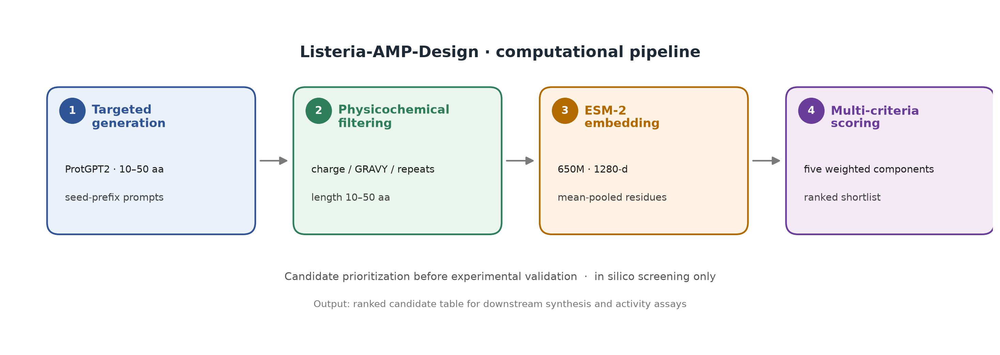

# Listeria-AMP-Design: A computational pipeline for designing anti-Listeria antimicrobial peptides

A computational pipeline based on generative protein models and ESM-2 embeddings for high-throughput design and pre-screening of anti-Listeria antimicrobial peptides, to provide ranked candidates for subsequent wet-lab validation.



---

## 1. 项目简介

本仓库提供一套可复现的 in silico 抗菌肽设计流程，覆盖四个连续阶段：

1. **定向短肽生成**：以已知抗菌肽的 N 端短片段为提示，使用 ProtGPT2 采样 10–50 aa 的候选序列；
2. **理化初筛**：按长度、净电荷、GRAVY、重复序列等规则快速过滤；
3. **ESM-2 表征**：提取 1280 维序列表征，用于衡量候选与已知高活性肽的序列空间邻近性；
4. **五指标综合评分**：整合 ESM-2 相似度、阳离子两亲性、螺旋倾向、疏水平衡与溶血风险，输出排序后的候选清单。

管线面向抗李斯特菌（*Listeria monocytogenes*）抗菌肽方向，也可通过替换参考肽集迁移到其他菌种或肽类。仓库仅包含计算流程、方法文档与小规模演示数据，不包含湿实验验证结果。

## 2. 核心特性

- **定向短肽生成**：优化 ProtGPT2 的提示与长度约束策略，定向产出 10–50 aa 短肽，缓解通用蛋白质语言模型偏好长序列的问题。
- **多维度初筛**：整合净电荷、GRAVY、连续重复与长度规则，快速剔除明显不符合抗菌肽理化特征的序列。
- **高精度表征**：基于 ESM-2（650M）提取序列特征，支持万级序列的批量处理与断点续跑。
- **综合评分排序**：五维度加权评分体系，输出优先开展合成与活性验证的候选清单。
- **可复现性强**：全流程脚本化，参数集中于 `config.yaml`，随机种子可固定，结果可追溯。

## 3. 目录结构

```
Listeria-AMP-Design/
├── README.md
├── LICENSE
├── requirements.txt
├── config.yaml                  # 统一参数入口
├── workflow.png                 # 四步管线示意图
├── .gitignore
├── src/
│   ├── 01_sequence_generation.py
│   ├── 02_physicochemical_filter.py
│   ├── 03_esm2_embedding.py
│   ├── 04_scoring_ranking.py
│   ├── common.py                # 配置、FASTA I/O、日志
│   └── physchem.py              # 理化描述符
├── data/
│   ├── example_input.fasta      # 40 条演示输入（含可通过与不通过初筛的序列）
│   ├── known_amps_example.csv   # 29 条已知抗李斯特菌肽示例子集（含 MIC 与溶血标签）
│   └── known_amps_example.fasta
├── docs/
│   ├── pipeline_method.md       # 方法学、指标定义与评价协议
│   └── parameter_details.md     # 参数、阈值与输出字段
└── examples/
    ├── example_scoring_result.csv
    ├── result_description.md
    ├── example_candidate_embeddings.npy
    ├── example_candidate_embedding_index.csv
    ├── example_known_embeddings.npy
    └── example_known_embedding_index.csv
```

`examples/` 中的 `.npy` 与索引文件是演示用的小规模预计算表征（30 条候选 + 29 条参考肽），用于在没有 GPU 和模型权重的情况下跑通第 2、4 步并复现示例输出；它们不是全量数据。

## 4. 环境与依赖

- Python ≥ 3.10
- PyTorch ≥ 2.0（生成与表征阶段需要；支持 CUDA 11.8/12.x）
- transformers ≥ 4.30
- numpy、scipy、scikit-learn、PyYAML

参考运行环境为 Python 3.10、PyTorch 2.x、CUDA 12.4；CPU 亦可运行，但生成与表征速度会明显下降。

```bash
python -m venv .venv
source .venv/bin/activate        # Windows: .venv\Scripts\activate
pip install -r requirements.txt
```

显存建议：ProtGPT2 以 FP16 推理约需 3–5 GB；ESM-2 650M 以 FP32 推理约需 4–8 GB。CPU 也可运行，但生成与表征速度显著降低。首次运行会从 Hugging Face 下载模型（ProtGPT2 约 1.5 GB，ESM-2 650M 约 2.5 GB）；离线环境可将模型下载到本地目录，并通过 `config.yaml` 的 `paths` 或 `--model` 指定。

## 5. 快速开始

### 5.1 准备输入

`data/known_amps_example.csv` 给出了参考肽表的最小格式：

```csv
peptide_id,source,sequence,length,mic_ug_ml,hemolytic
DRAMP::DRAMP03826,DRAMP,KNLRRIIRKIIHIIKKYG,18,0.3,1
```

- `sequence`：标准单字母氨基酸序列；
- `mic_ug_ml`：抗李斯特菌 MIC（μg/mL），用于定义高活性参考集；
- `hemolytic`：1 表示溶血、0 表示非溶血、留空表示未知。

替换为自己的数据时，保持列名不变即可。

> 示例参考肽仅 29 条，3 aa 提示前缀的多样性有限，适合流程演示；大规模生成建议使用更完整的参考肽集（例如 200 条以上），以获得更丰富的提示空间。

### 5.2 运行四步管线

```bash
# 1) 定向生成
python src/01_sequence_generation.py \
  --seeds data/known_amps_example.csv \
  --out-dir runs/01_generation \
  --target 100000 \
  --device cuda

# 2) 理化初筛
python src/02_physicochemical_filter.py \
  --input runs/01_generation/generated_sequences.fasta \
  --exclude data/known_amps_example.csv \
  --out-dir runs/02_filter

# 3) ESM-2 表征（候选库与参考肽分别表征）
python src/03_esm2_embedding.py \
  --input runs/02_filter/screened_physchem.fasta \
  --out-dir runs/03_embedding \
  --device cuda

python src/03_esm2_embedding.py \
  --input data/known_amps_example.fasta \
  --out-dir runs/03_known \
  --device cuda

# 4) 五指标评分与排序
python src/04_scoring_ranking.py \
  --physchem runs/02_filter/screened_physchem.csv \
  --embeddings runs/03_embedding/esm2_embeddings.npy \
  --embedding-index runs/03_embedding/esm2_embedding_index.csv \
  --known-amps data/known_amps_example.csv \
  --known-embeddings runs/03_known/esm2_embeddings.npy \
  --known-embedding-index runs/03_known/esm2_embedding_index.csv \
  --out-dir runs/04_scoring \
  --top-n 100
```

所有路径均为相对路径；参数优先从 `config.yaml` 读取，命令行参数可覆盖关键项。

### 5.3 无模型演示（CPU）

仓库提供了 30 条候选肽的预计算表征，可直接复现示例输出：

```bash
python src/02_physicochemical_filter.py \
  --input data/example_input.fasta \
  --exclude data/known_amps_example.csv \
  --out-dir runs/demo/02_filter

python src/04_scoring_ranking.py \
  --physchem runs/demo/02_filter/screened_physchem.csv \
  --embeddings examples/example_candidate_embeddings.npy \
  --embedding-index examples/example_candidate_embedding_index.csv \
  --known-amps data/known_amps_example.csv \
  --known-embeddings examples/example_known_embeddings.npy \
  --known-embedding-index examples/example_known_embedding_index.csv \
  --out-dir runs/demo/04_scoring
```

预期：40 条输入中 30 条通过初筛；`runs/demo/04_scoring/scoring_result.csv` 与 `examples/example_scoring_result.csv` 的排序与分值一致（浮点末位可能因平台略有差异）。

## 6. 示例输出

示例库（30 条候选、29 条参考肽）的 Top5：

| Rank | Peptide ID | Sequence | Length | Score |
|---:|---|---|---:|---:|
| 1 | gen_086877 | `PKIVPLVKKKLRKLGL` | 16 | 80.70 |
| 2 | gen_041754 | `KRILKALKDTKAKKAIILGCTELPILVKEAKLKNIEVI` | 38 | 77.01 |
| 3 | gen_051131 | `KFFSRIWGFFKIFFGKFFDKLLEKFS` | 26 | 75.76 |
| 4 | gen_088246 | `RRLALAGLPDVAVRRVARRAAGGARLAV` | 28 | 75.73 |
| 5 | gen_091582 | `WGRLAGGRLRLLAERRLSRVPARLAVVSL` | 29 | 75.51 |

注意：示例分值基于 30 条候选的相对百分位排名，仅用于演示流程；在完整库上，同一序列的分值会随背景集变化。字段说明见 [`examples/result_description.md`](examples/result_description.md)。

## 7. 方法概要

### 7.1 定向生成

从参考肽的 10–50 aa 片段中取 N 端 3 aa 作为提示（prompt），每个提示采样 10 条，单批 20 个提示；`temperature=0.85`、`top_p=0.9`、`top_k=40`、`repetition_penalty=1.2`。生成结果截断至 50 aa，去除短于 10 aa、含非标准字符、与参考集或已生成集合重复的序列。

### 7.2 理化初筛

保留满足以下条件的序列：长度 10–50 aa；仅含 20 种标准氨基酸；无 ≥5 个相同残基的连续片段；pH 7.4 净电荷 ∈ [−2, +6]；GRAVY ∈ [−1.5, +1.0]；与参考肽及输入内部无精确重复。

### 7.3 ESM-2 表征

使用 `facebook/esm2_t33_650M_UR50D`，取最后一层隐状态，对残基位置做平均池化（排除 BOS/EOS），得到 1280 维向量。打分前以参考肽表征的均值中心化，消除嵌入空间的公共分量。

### 7.4 五指标评分

```
score = 100 × (0.45·W1 + 0.20·W2 + 0.15·W3 + 0.10·W4 + 0.10·W5)
```

| 分量 | 定义 | 权重 |
|---|---|---:|
| W1 | 中心化 ESM-2 余弦相似度相对高活性参考肽质心的百分位秩 | 0.45 |
| W2 | 阳离子残基比例与疏水矩 μH 的百分位秩均值 | 0.20 |
| W3 | Chou–Fasman 螺旋倾向 Pa 的百分位秩 | 0.15 |
| W4 | `exp(−((GRAVY − 0.2)/0.5)²)` | 0.10 |
| W5 | 1 − 溶血风险 | 0.10 |

高活性参考集定义为 MIC ≤ 参考集中位数的肽。溶血风险优先使用参考肽溶血标签训练的逻辑回归模型（ESM-2 表征输入，五折交叉验证）；当标签不足或交叉验证区分度低于阈值时，退化为理化启发式评分。详细公式与选择依据见 [`docs/pipeline_method.md`](docs/pipeline_method.md)，全部参数见 [`docs/parameter_details.md`](docs/parameter_details.md)。

## 8. 参考运行结果

以下数值来自完整库的参考运行，用于说明方法行为；仓库中的 40 条演示数据不足以复现这些统计量。

| 评价项目 | 结果 |
|---|---|
| 同预算三组对照（173,200 次采样） | 无长度约束的原始生成 10–50 aa 产出率 30.3%；定向生成 57.8% |
| 回顾性留出验证（5 折，每折 7 条高活性肽，54,181 条生成肽为背景池） | Mann–Whitney AUC 0.749（完整评分）vs 0.753（仅理化）；Top1% 召回 17.1% vs 2.9% |
| 评分消融（Top100 重叠） | 仅理化 23 条；理化+ESM-2 43 条；五指标等权 53 条；强化 ESM 权重 67 条 |

回顾性 AUC 以已知高活性肽为正样本、全部生成肽为未标注背景池计算，等价于以未标注背景为负类的排序 AUC；背景并非确证阴性，因此不应解读为标准分类任务的 ROC-AUC。

## 9. 研究说明与局限

> 本工作为纯计算层面的分子预筛选方案。计算模拟能够快速缩小候选范围、降低后续实验的试错成本，但模型预测结果存在固有不确定性。本项目开源，旨在开放整套工作流，欢迎同行对筛选逻辑、评价指标、模型策略进行讨论、复现与迭代优化，相关活性与安全性结论仍需要后续湿实验予以佐证。

具体边界：

- **仅为 in silico 预筛选**：评分不等同于抗菌活性、毒性或食品安全性结论；候选肽仍需体外 MIC/MBC、溶血与食品基质实验验证。
- **分值为相对排序**：W1–W3 使用当前输入库内的百分位秩，替换候选集或参考集会改变分值，不能跨数据集直接比较。
- **参考集依赖**：高活性阈值由参考肽 MIC 中位数决定；参考集规模、来源与菌株差异会影响 W1 与 W5。
- **溶血模型为探索性**：标签数量有限，交叉验证区分度中等；W5 只作为温和惩罚项，不构成安全性预测。
- **模型偏差**：ProtGPT2 与 ESM-2 均在通用蛋白质数据上训练，可能继承数据偏倚；生成序列的理化合理性与可合成性需另行评估。
- **流程范围**：本仓库覆盖生成、初筛、表征与评分四步；膜对接、分子动力学、结构预测等属于独立的下游探索，不在本仓库范围内。

## 10. 数据与模型可用性

- 仓库仅包含小规模演示数据；完整生成库、表征矩阵与中间结果不随仓库分发，可按第 5 节流程重新生成。
- ProtGPT2 与 ESM-2 权重由 Hugging Face 提供，需遵循各自模型卡与许可条款。
- 参考肽来自 DRAMP、APD 与 DBAASP 公共数据库；使用时请遵守各数据库的引用与使用要求。

## 11. 引用

如使用本流程，请引用所依赖的模型与数据库：

```bibtex
@article{ferruz2022protgpt2,
  title   = {ProtGPT2 is a deep unsupervised language model for protein design},
  author  = {Ferruz, Noelia and Schmidt, Steffen and H{\"o}cker, Birte},
  journal = {Nature Communications},
  volume  = {13},
  number  = {1},
  pages   = {4348},
  year    = {2022}
}

@article{lin2023esm2,
  title   = {Evolutionary-scale prediction of atomic-level protein structure with a language model},
  author  = {Lin, Zeming and Akin, Halil and Rao, Roshan and others},
  journal = {Science},
  volume  = {379},
  number  = {6637},
  pages   = {1123--1130},
  year    = {2023}
}
```

数据库：DRAMP（Antimicrobial Peptide Database）、APD（Antimicrobial Peptide Database, aps.unmc.edu）、DBAASP（Database of Antimicrobial Activity and Structure of Peptides）。

## 12. 开源协议

本项目采用 [MIT License](LICENSE)。欢迎在署名与保留许可声明的前提下复用、修改与再分发。
